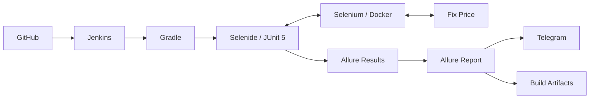
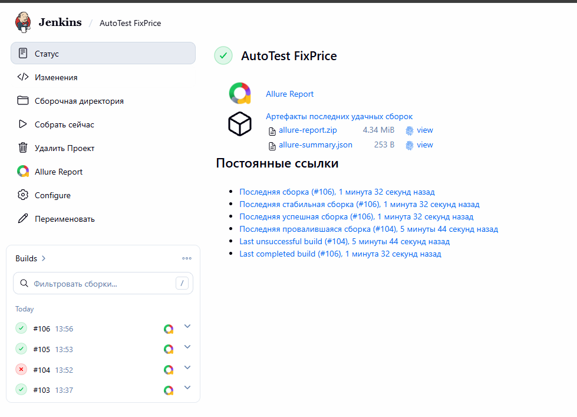
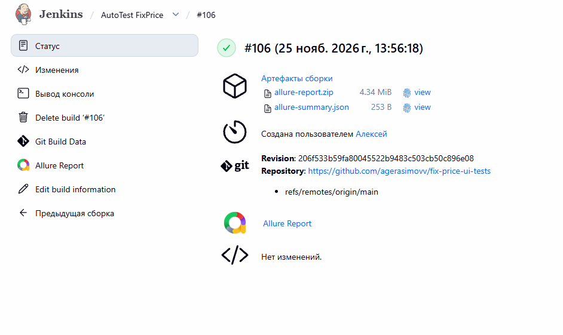
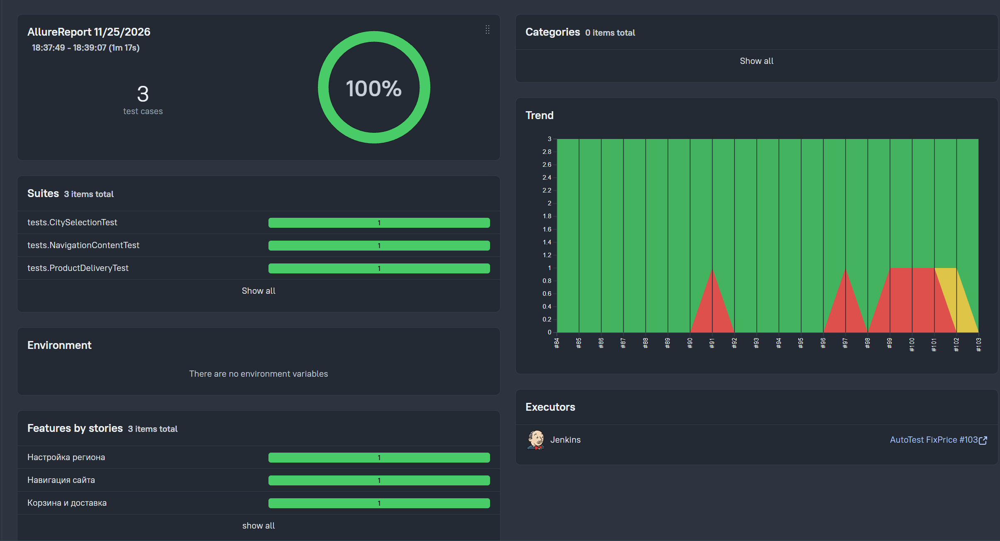
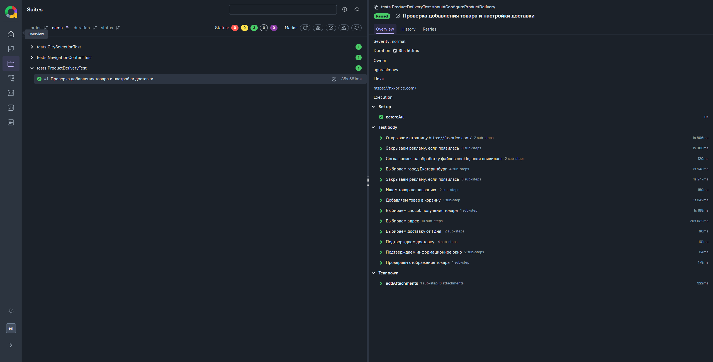
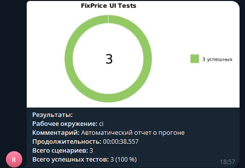

# 🛒 Проект автоматизации тестирования интернет-магазина Fix Price

<p align="center">
  <a href="https://fix-price.com/">
    
  </a>
</p>

Самостоятельный учебный проект по автоматизации UI-тестирования интернет-магазина [Fix Price](https://fix-price.com/).

Автотесты реализованы на Java с использованием Selenide и JUnit 5. Настроены удалённый запуск через Jenkins, браузерное окружение в Docker, формирование Allure Report, архивирование артефактов сборки и автоматическая отправка результатов в Telegram.

## 📖 Содержание

- [Технологии и инструменты](#stack)
- [Реализованные тестовые сценарии](#tests)
- [Архитектура проекта](#architecture)
- [Локальный запуск](#local)
- [Удалённый запуск через Jenkins](#jenkins)
- [Отчётность Allure Report](#allure)
- [Уведомления в Telegram](#telegram)

<a id="stack"></a>

## 🛠 Технологии и инструменты

<p align="center">
  
  
  
  
  
  
  
  
  
  
  
</p>

<a id="tests"></a>

## ✅ Реализованные тестовые сценарии

### Настройка региона

- [x] Открытие сайта и обработка всплывающих окон.
- [x] Выбор города Екатеринбург.
- [x] Проверка выбранного города.

### Навигация сайта

- [x] Проверка текстового содержимого шапки сайта.
- [x] Проверка элементов навигационного меню.
- [x] Проверка содержимого футера.

### Корзина и доставка

- [x] Поиск товара по названию.
- [x] Добавление товара в корзину.
- [x] Выбор способа получения товара.
- [x] Заполнение адреса доставки.
- [x] Выбор варианта доставки.
- [x] Подтверждение параметров доставки.
- [x] Подтверждение информационного окна.
- [x] Проверка отображения выбранного товара.

| Тестовый класс | Назначение |
|---|---|
| `CitySelectionTest` | Проверка настройки региона |
| `NavigationContentTest` | Проверка навигации и текстового содержимого сайта |
| `ProductDeliveryTest` | Проверка добавления товара и настройки доставки |

<a id="architecture"></a>

## 📂 Архитектура проекта

```text
fix-price-ui-tests/
├── media/
│   └── screenshots/
├── notification/
│   └── allure-notifications-4.11.1.jar
├── src/test/java/
│   ├── helpers/
│   │   └── Attach.java
│   ├── pages/
│   │   └── PageObjectLocal.java
│   ├── testdata/
│   │   └── FooterTestData.java
│   └── tests/
│       ├── CitySelectionTest.java
│       ├── NavigationContentTest.java
│       ├── ProductDeliveryTest.java
│       └── TestBase.java
├── gradle/
├── .gitignore
├── build.gradle
├── settings.gradle
├── gradlew
├── gradlew.bat
└── README.md
```

### Особенности реализации

- Использование паттерна Page Object.
- Использование Fluent Interface для последовательного вызова методов.
- Централизованная конфигурация браузера.
- Разделение тестовой логики и тестовых данных.
- Динамические ожидания Selenide.
- Группировка тестов с помощью аннотаций Allure.
- Детализация сценариев через Allure Steps.
- Прикрепление скриншотов, HTML-кода страницы и логов браузера.
- Передача параметров запуска через системные свойства.
- Автоматическое закрытие WebDriver после выполнения тестов.
- Архивирование результатов тестирования в Jenkins.

### Основные классы

| Класс | Назначение |
|---|---|
| `PageObjectLocal` | Локаторы и методы взаимодействия с интерфейсом |
| `TestBase` | Конфигурация браузера и жизненный цикл тестов |
| `Attach` | Прикрепление дополнительных материалов к Allure Report |
| `FooterTestData` | Хранение ожидаемых текстовых значений элементов сайта |

### Основные зависимости

| Библиотека | Версия |
|---|---|
| Selenide | 7.18.2 |
| JUnit Jupiter | 5.10.2 |
| Datafaker | 2.7.0 |
| Allure Selenide | 2.35.5 |
| Allure JUnit 5 | 2.35.5 |
| Allure Gradle Plugin | 4.3.0 |
| Allure Notifications | 4.11.1 |

<a id="local"></a>

## 💻 Локальный запуск

### Клонирование репозитория

```bash
git clone https://github.com/agerasimovv/fix-price-ui-tests.git
cd fix-price-ui-tests
```

### Запуск всех тестов на Windows

```powershell
.\gradlew.bat clean test
```

### Запуск на Linux / macOS

```bash
./gradlew clean test
```

### Запуск отдельного тестового класса

```powershell
.\gradlew.bat test --tests "tests.ProductDeliveryTest"
```

### Формирование и открытие Allure Report

```powershell
.\gradlew.bat allureServe
```

<a id="jenkins"></a>

## 🚀 Удалённый запуск через Jenkins

Jenkins и Selenium Standalone Chrome развёрнуты в отдельных Docker-контейнерах.

Jenkins загружает исходный код из GitHub и запускает автотесты через Gradle. Взаимодействие с браузером осуществляется через удалённый WebDriver.

### Схема выполнения автотестов



### Команда удалённого запуска

```bash
./gradlew clean test -Dselenide.remote=http://selenium-chrome:4444
```

Адрес удалённого WebDriver доступен внутри общей Docker-сети.

### Главная страница Jenkins Job

<p align="center">
  
</p>

### Результаты успешной сборки

После выполнения тестов Jenkins сохраняет артефакты:

- `allure-report.zip` — архив сформированного отчёта.
- `allure-summary.json` — сводка результатов тестирования.

<p align="center">
  
</p>

<a id="allure"></a>

## 📊 Отчётность Allure Report

По результатам выполнения автотестов автоматически формируется Allure Report.

Отчёт содержит общую статистику, результаты выполнения сценариев, продолжительность тестирования и историю предыдущих запусков.

### Общая статистика выполнения тестов

<p align="center">
  
</p>

### Детализация тестовых сценариев

Для структурирования отчётности используются аннотации `@Feature`, `@Story`, `@DisplayName`, `@Owner` и `@Link`.

В отчёте доступны:

- Статус выполнения тестового сценария.
- Последовательность действий и проверок.
- Продолжительность выполнения каждого шага.
- Скриншоты браузера.
- HTML-код страницы.
- Логи консоли браузера.
- Информация об ошибках.

<p align="center">
  
</p>

<a id="telegram"></a>

## 📱 Уведомления в Telegram

После завершения тестирования и формирования Allure Report результаты автоматически отправляются в Telegram с помощью Allure Notifications.

Уведомление содержит:

- Название проекта.
- Информацию об окружении.
- Продолжительность тестирования.
- Общее количество тестовых сценариев.
- Статистику результатов выполнения.

Конфигурационный файл с токеном Telegram-бота исключён из системы контроля версий.

<p align="center">
  
</p>

---

<p align="center">
  <b>Java • Selenide • JUnit 5 • Jenkins • Docker • Allure</b>
</p>
